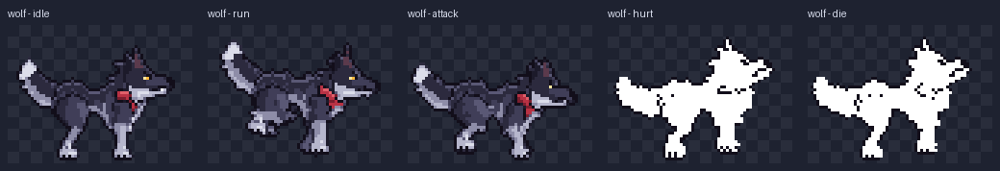
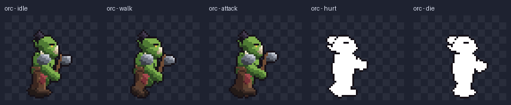
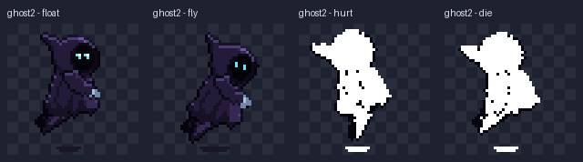
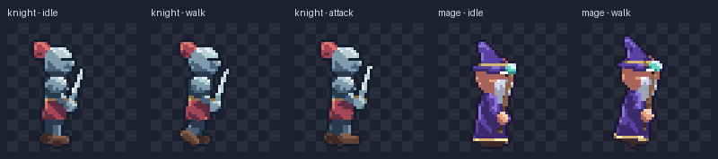
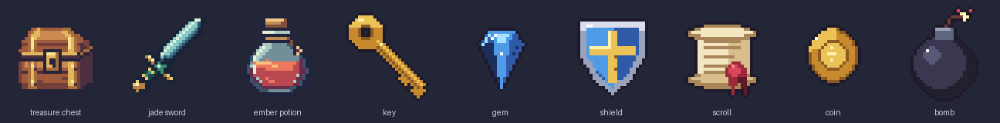
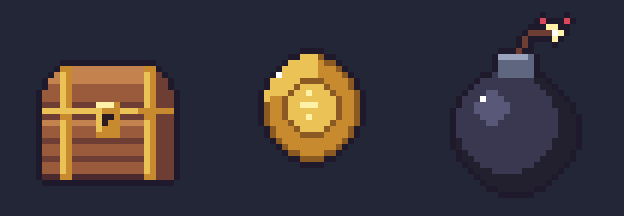
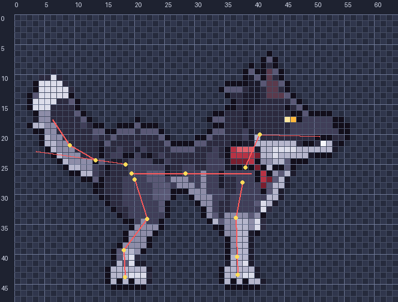

<div align="center">

# Pixel Forge

**Pixel art game assets from editable JSON and code. No image-generation model.**

Every pixel comes from a short spec your agent writes and a renderer that runs locally with Python and Pillow.
It makes static items as well as animated characters and mobs, with sprite sheets ready for a game.



</div>

## Showcase

### Mobs

Each mob has a full set of animations: idle, a move, attack, hurt and die.





### Heroes



### Items





## What it does

| | |
|---|---|
| **Static assets** | Items, icons and tiles drawn as palette-indexed layers (rows of symbols plus polygons, rects, lines and pixels). Each one is rendered to a native transparent PNG, an enlarged preview and a coordinate grid, and stays patchable by layer. |
| **Rigged characters** | `humanoid`, `chibi` and `quadruped` skeletons, posed by animation presets: idle, walk, run, float, attack, hurt and die. Effects include a hit flash, a dither dissolve and lying poses that rest on the ground line. |
| **Two quality paths** | **Vector parts** (shapes on bones, auto-shaded) are quick for prototypes. **Cutout layers** are pixel regions painted once in the rest pose and rotated RotSprite-style, for final art. |
| **Game-ready output** | Each animation is exported as a sprite sheet, plus `animation.json` with frame rects, timings and a pivot per frame, a preview GIF and a contact sheet. |
| **Editable to the pixel** | Per-frame `touchups` live in the spec and survive re-renders. Every frame is also exported as editable JSON and checked to reproduce exactly. |

## How it works



1. **Pick a rig and pose it.** The spec names a skeleton, its proportions and a posture. Run `--rest` to see the bones on a labeled grid.
2. **Attach the art.** You either give each bone a vector shape, or paint cutout regions around the bones with `draw` ops (`poly`, `band`, `clip`, `rim`, `px`). The renderer splits each region onto the nearest bones by itself.
3. **List the animations.** Each animation is a preset with a few parameters, for example `{"preset": "run", "stride": 36}`. The presets compute every frame.
4. **Render, inspect, touch up.** Check the key frames, then fix individual pixels with `touchups`.

A whole animated character fits in a few dozen lines of JSON. The agent never has to write frames by hand.

<br clear="right">

## Quick start

You need Python 3.10+ and Pillow 9.1+.

```bash
git clone https://github.com/haidang1810/pixel-forge.git
cd pixel-forge
python -m unittest discover -s skills/pixel-forge/scripts/tests
```

Render the wolf, then make a preview GIF:

```bash
python skills/pixel-forge/scripts/rig2d.py prototype/rig2d/examples/wolf3.json --out output/wolf
python skills/pixel-forge/scripts/showcase.py wolf/idle wolf/run wolf/attack --root output --out wolf.gif
```

Render a static item:

```bash
python skills/pixel-forge/scripts/pixel_art.py render demo/items/key.json --out output/key --scale 8 --grid
```

Regenerate every image in this README:

```bash
python demo/make_readme_media.py
```

## Use it as an agent skill

Copy `skills/pixel-forge` into your agent's skills folder (for Codex, `~/.codex/skills/pixel-forge`), then ask for an asset:

> `$pixel-forge` make a dark hooded ghost that floats above the ground, with float, hurt and death animations.

> `$pixel-forge` make a set of 32×32 dungeon items: a chest, a key and a health potion.

The skill reads `SKILL.md` and the references (`format.md` for static JSON, `rig.md` for characters and animation). It writes the spec, renders, inspects the frames and delivers the sheets.

## Repository layout

```text
skills/pixel-forge/          the skill: SKILL.md, references, scripts and tests
  scripts/pixel_art.py       static renderer and patch tool
  scripts/rig2d.py           rigged characters and animation export
  scripts/rig_presets.py     rigs and animation presets
  scripts/cutout_tools.py    draw ops and splitting cutout regions onto bones
prototype/rig2d/examples/    character specs (knight, mage, orc, wolves, ghosts)
demo/items/                  item sources (editable JSON) and their build script
demo/make_readme_media.py    rebuilds docs/images
evaluation/                  early baseline and tool-review material
```

## Limits

- Characters are side view, facing right. Turnarounds and top-down directions are not generated.
- Pixels are opaque or transparent; there is no blended alpha.
- Motions beyond the presets need a new preset function.
- Generated characters reach clean indie quality, especially with cutout layers and hand touch-ups, but are not guaranteed to match hand-made commercial pixel art.
